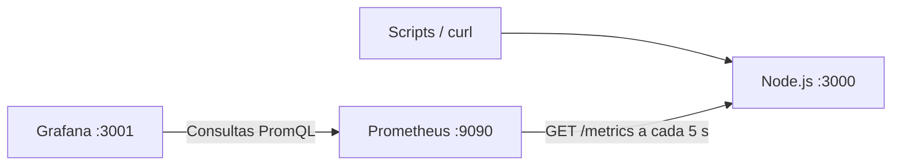

# Prometheus & Grafana Monitoring Lab

Laboratório local de observabilidade para aprender a instrumentar aplicações, recolher métricas, criar dashboards e investigar falhas. Uma API Node.js fornece cenários de tráfego, erros e lentidão; Prometheus e Grafana permitem observar o que acontece e acompanhar a recuperação.

O dashboard, o Data Source e os alertas são provisionados por ficheiros. Depois de iniciar os serviços, podes explorar os indicadores sem escrever consultas. Para praticar PromQL, usa os exemplos em [`queries.promql`](queries.promql).

## O que podes praticar

- Métricas HTTP: tráfego, percentagem de erros e latência p95.
- Counters, histogramas, labels e séries temporais.
- Dashboards Grafana e consultas PromQL.
- Alertas com períodos de espera e volume mínimo de tráfego.
- Diagnóstico de indisponibilidade, falhas funcionais e recuperação.

## Arquitetura



O Prometheus guarda as amostras na sua base de séries temporais. O Grafana consulta esses dados para apresentar os painéis e avaliar alertas. Os endpoints `/metrics` apresentam métricas atuais; o histórico é consultado através do Prometheus ou do dashboard.

## Arranque rápido

Precisas de Docker com Compose v2, `curl`, `openssl` e um shell POSIX, como no Linux, macOS ou WSL. Python 3 é opcional para executar a verificação da integração.

```bash
git clone https://github.com/Mario-Coxe/prometheus-promql-lab.git
cd prometheus-promql-lab
./lab.sh init
docker compose up --build -d
docker compose ps
```

Espera que `api`, `prometheus` e `grafana` estejam `Up`, depois aguarda cerca de 30 segundos para as primeiras recolhas.

Entra no Grafana com o utilizador **admin** e a password gerada em `.env`. Para consultá-la localmente:

```bash
cat .env
```

`init` cria credenciais aleatórias com permissões `0600` e mantém um `.env` já existente. Este ficheiro é ignorado pelo Git e pelo build Docker. Para configuração manual, copia [`.env.example`](.env.example) e define uma password não vazia. A password configura o administrador apenas na criação da BD Grafana; alterações posteriores devem ser feitas no perfil do utilizador.

| Serviço | Endereço |
| --- | --- |
| Grafana | http://127.0.0.1:3001 |
| Dashboard | http://127.0.0.1:3001/d/application-support-monitoring-lab |
| API | http://127.0.0.1:3000/health |
| Métricas Node.js | http://127.0.0.1:3000/metrics |
| Prometheus | http://127.0.0.1:9090 |
| Targets | http://127.0.0.1:9090/targets |

Os serviços ficam acessíveis apenas na máquina local. Os scripts usam `127.0.0.1` para atingir as portas IPv4 publicadas pelo Docker, evitando que `localhost` resolva para outro servidor em IPv6. Na rede Docker, o Grafana consulta `http://prometheus:9090` e o Prometheus recolhe `http://api:3000/metrics`.

## Explorar o dashboard

Abre **Dashboards → Application Support → Application Support — Monitoring Lab**. O intervalo inicial é de **7 dias**, com atualização automática desativada. Usa o botão de atualização para consultar os dados mais recentes.

Gera os primeiros dados:

```bash
./lab.sh status
./lab.sh normal 90
```

`status` deve devolver `{"status":"ok"}`. Durante o tráfego normal, observa os seguintes painéis:

| Painel | Indicador |
| --- | --- |
| API Status | Sucesso do scrape no instante final selecionado: `UP` verde ou `DOWN` vermelho |
| Requests Per Second | Média de pedidos/s sobre as amostras disponíveis no período selecionado |
| HTTP 500 Error Rate | Percentagem estimada de respostas HTTP 500 no período selecionado |
| Errors by Endpoint | Quantidade estimada de HTTP 500 por rota no período selecionado |
| P95 Latency by Endpoint | Evolução do P95 por rota em segundos, com janela adaptada à escala do gráfico |
| Memory Usage | Memória residente do processo Node.js em MiB no instante final selecionado |
| Top 5 Endpoints | Até cinco rotas com mais pedidos estimados no período selecionado |

Passa o cursor sobre o gráfico para consultar valores e horários. Usa a legenda para mostrar ou ocultar rotas e o seletor de tempo para explorar outros intervalos.

Para consultar todo o histórico disponível, define uma data inicial em **From** e `now` em **To**, depois aplica o intervalo. Os totais e a percentagem de erros seguem esse período. O gráfico de P95 mostra a evolução ao longo do tempo, não um único percentil de todo o período. Só é possível consultar dados ainda guardados pelo Prometheus.

O intervalo de atualização da página e o período analisado são independentes. Mesmo com a atualização automática desativada, o Prometheus continua a recolher métricas a cada 5 s e os alertas continuam a ser avaliados. Para acompanhar uma simulação em tempo real, podes ativar temporariamente a atualização no seletor junto ao botão de refresh.

As estatísticas continuam a incluir tráfego antigo enquanto ele fizer parte do período selecionado; escolhe um período mais curto para investigar o comportamento recente. Rotas ainda não utilizadas não aparecem. O P95 precisa de pedidos na janela de cada ponto. `increase` estima contagens e pode produzir frações. A rota `/slow` demora aproximadamente 1,2 s, mas o P95 pode aproximar-se de 2,5 s devido aos buckets do histograma.

**`UP` não significa que todas as funcionalidades estejam saudáveis:** a rota `/error` pode devolver 500 enquanto o scrape continua bem-sucedido. `NO DATA` também não equivale a uma aplicação saudável.

## Exercícios

Executa um cenário de cada vez, com o dashboard aberto. Os argumentos numéricos representam segundos; `Ctrl+C` termina a geração de tráfego.

| Comando | Cenário | O que observar |
| --- | --- | --- |
| `./lab.sh status` | Consultar `/health` | Resposta `{"status":"ok"}` |
| `./lab.sh normal 90` | Pedidos a `/ok` | Aumento de RPS e tráfego por rota |
| `./lab.sh slow 30` | Pedidos a `/slow` | Aumento da latência p95 |
| `./lab.sh errors 120` | Alternar `/ok` e `/error` | Erros por rota e alerta de taxa de erros |
| `./lab.sh normal 300` | Tráfego sem novos erros | Recuperação do alerta à medida que os erros saem da sua janela de 5 minutos |
| `./lab.sh down` | Parar apenas a API | Estado DOWN e alerta de indisponibilidade |
| `./lab.sh recover` | Voltar a iniciar a API | Estado UP e resolução do alerta |
| `./traffic.sh` | Misturar os três tipos de pedido | 25 respostas OK, 25 erros 500 e 5 respostas lentas |

O `traffic.sh`, sozinho numa janela sem tráfego anterior, não atinge o mínimo de 100 pedidos exigido pelo alerta de erros. Usa `errors 120` para esse exercício. `API_URL` permite mudar o endereço usado pelos scripts HTTP.

Para relacionar as métricas com os logs:

```bash
docker compose logs api --tail=20
```

## Alertas

Abre http://127.0.0.1:3001/alerting/list e procura as regras **Grafana-managed**, na pasta **Application Support**. São avaliadas a cada **10 segundos**.

| Regra | Avaliação | Condição | Pending | Severidade |
| --- | --- | --- | --- | --- |
| API Down | Grafana | `up{job="api"} == 0` | 30 s | critical |
| High HTTP 500 Error Rate | Grafana | Mais de 5% de erros em 5 min, com pelo menos 100 pedidos estimados/5 min e scrape UP | 1 min | warning |
| ApiIndisponivel | Prometheus | `up{job="api"} == 0` | 15 s | critical |

Para acompanhar **Normal → Pending → Firing**:

1. Com a API disponível, executa `./lab.sh down` e mantém a página dos alertas aberta. A condição de indisponibilidade deve permanecer verdadeira durante 30 s; incluindo scrape e avaliação, conta com cerca de 35–50 s até Firing.
2. Executa `./lab.sh recover`. Depois do novo scrape e da avaliação seguinte, o alerta deve regressar a Normal.
3. Executa `./lab.sh errors 120`. A regra de erros entra em Pending quando ultrapassa 5% e cumpre o volume mínimo; dispara após 1 minuto de condição contínua. O tráfego anterior pode alterar o tempo necessário.
4. Executa `./lab.sh normal 300`. Aguarda a saída dos erros da janela de 5 minutos e confirma a recuperação.

A regra de erros devolve zero sem tráfego, abaixo do volume mínimo ou com a API DOWN. Falhas de consulta e ausência de séries `up` são tratadas como **Error/No Data**.

`ApiIndisponivel` permite comparar os mecanismos de avaliação: aparece em http://127.0.0.1:9090/alerts e é avaliada pelo Prometheus a cada 5 s. Não há encaminhamento para um Alertmanager externo, por isso esta regra não envia notificações. Evita encaminhar o mesmo incidente pelos dois sistemas ao adaptar o laboratório.

### Notificações

As notificações externas estão desativadas. O Contact Point `lab-disabled` usa o endereço reservado `lab@example.invalid`; a política de `environment=lab` silencia notificações todos os dias e o SMTP está desativado. Os alertas continuam a ser avaliados e a apresentar os seus estados.

Para configurar um destino real, cria o Contact Point, atualiza o receiver em [`notifications.yml`](grafana/provisioning/alerting/notifications.yml) e remove o mute da política. Para email, configura também SMTP. Mantém credenciais em variáveis locais ou segredos, fora dos ficheiros versionados.

## Verificar a instalação

Com os serviços disponíveis:

```bash
docker compose config --quiet
docker compose exec prometheus promtool check config /etc/prometheus/prometheus.yml
docker compose exec prometheus promtool check rules /etc/prometheus/alerts.yml
python3 verify.py
```

O script verifica as rotas, HTTP 500, latência, métricas, scrape UP, ligação Grafana → Prometheus, sete painéis, consultas PromQL, avaliação dos dois alertas e política silenciada. Gera alguns pedidos, incluindo um erro 500. Os exercícios acima verificam as transições temporais dos alertas.

Na validação das consultas, o script substitui as variáveis de tempo do Grafana por intervalos de teste de 15 min e 1 min. Os alertas mantêm as suas janelas fixas, independentemente do período escolhido no dashboard; por isso a percentagem global do painel pode diferir da taxa recente que dispara um alerta.

As credenciais são lidas de `.env` ou de `GRAFANA_ADMIN_USER`/`GRAFANA_ADMIN_PASSWORD`. Se alteraste a password na interface, fornece a atual através do ambiente. Os endereços podem ser ajustados com `API_URL`, `PROMETHEUS_URL` e `GRAFANA_URL`.

O workflow [Lab checks](.github/workflows/ci.yml) executa as verificações de sintaxe e integração no GitHub Actions. Consulta o resultado de cada execução no separador **Actions**.

## Resolução de problemas

| Sintoma | Verificação |
| --- | --- |
| Grafana não aparece em `docker ps` | Executa `docker compose ps -a` e `docker compose logs grafana --tail=80` |
| `/health` devolve 404 em `localhost` | Usa `http://127.0.0.1:3000/health`; outro processo pode estar a responder em IPv6 |
| Painéis sem dados | Confirma o target `api` em `/targets`, gera tráfego e aguarda pelo menos duas recolhas |
| Alerta de erros não dispara | Confirma o mínimo de 100 pedidos/5 min, a percentagem acima de 5% e o pending de 1 min |
| Erros continuam no dashboard depois de terminar o script | O período selecionado ainda inclui esses erros; escolhe um intervalo mais recente |
| Login falha após alterar `.env` | A BD mantém a password anterior; mudar `.env` não redefine um utilizador existente |

Para recuperar os serviços:

```bash
docker compose start api
docker compose up --build -d
```

## Personalizar e contribuir

| Ficheiro ou pasta | Responsabilidade |
| --- | --- |
| `server.js` | API e instrumentação das métricas |
| `prometheus.yml` | Targets e intervalos de recolha |
| `alerts.yml` | Regra avaliada pelo Prometheus |
| `grafana/dashboards/` | Definição JSON dos painéis |
| `grafana/provisioning/` | Data Source, dashboard, alertas e política de notificações |
| `lab.sh` / `traffic.sh` | Cenários para gerar dados e simular falhas |
| `queries.promql` | Consultas para explorar as métricas |
| `verify.py` | Verificação da integração |

Para alterar recursos provisionados, edita os ficheiros e executa `docker compose restart grafana`. Para alterar a API, executa `docker compose up --build -d api`.

Sugestões, correções e novos exercícios são bem-vindos através de issues e pull requests. Inclui o comportamento esperado e como reproduzir ou testar a alteração. Executa as verificações antes de submeter e não incluas `.env` nem credenciais.

## Persistência e limpeza

`prometheus_data` guarda as séries temporais em `/prometheus`. `grafana_data` guarda a BD interna, utilizadores e configuração do Grafana em `/var/lib/grafana`.

```bash
docker compose down
```

Para os serviços e mantém os dados. Para eliminar também **ambos os volumes**, executa `docker compose down -v`.

## Referências

- [Conceitos do Prometheus](https://prometheus.io/docs/concepts/data_model/)
- [Introdução ao PromQL](https://prometheus.io/docs/prometheus/latest/querying/basics/)
- [Provisionamento do Grafana](https://grafana.com/docs/grafana/latest/administration/provisioning/)
- [Provisionamento de alertas](https://grafana.com/docs/grafana/latest/alerting/set-up/provision-alerting-resources/file-provisioning/)
